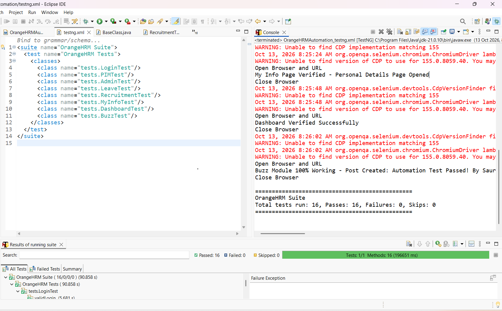

# OrangeHRM Automation Framework - Selenium | TestNG | POM

🚀 **Live Demo Tested:** https://opensource-demo.orangehrmlive.com

Manual Testing
- **File:** `Manual_Testing/OrangeHRM_Full_Manual_TestCases.xlsx`
- **Total Test Cases:** 32 (Login, Admin, PIM, Leave, Buzz etc.)
- **Status:** All Pass
- **Tools:** Excel, Jira style format

### 2. Automation Testing
- Framework: Selenium + TestNG + POM
- Reports: Extent Report with Screenshots

### 📊 Project Stats
- 8 Modules Automated: Login, PIM, Admin, Leave, Recruitment, MyInfo, Dashboard, Buzz
- 15 Test Cases | 100% Pass Rate | Page Object Model

### 🛠️ Tech Stack
Java | Selenium 4 | TestNG | Maven | Git | Extent Reports | WebDriverWait

### ▶️ Run
mvn clean test

## Test Execution Screenshot

### 👨‍💻 Author
Saurabh Yevale | QA Automation Tester | Pune
